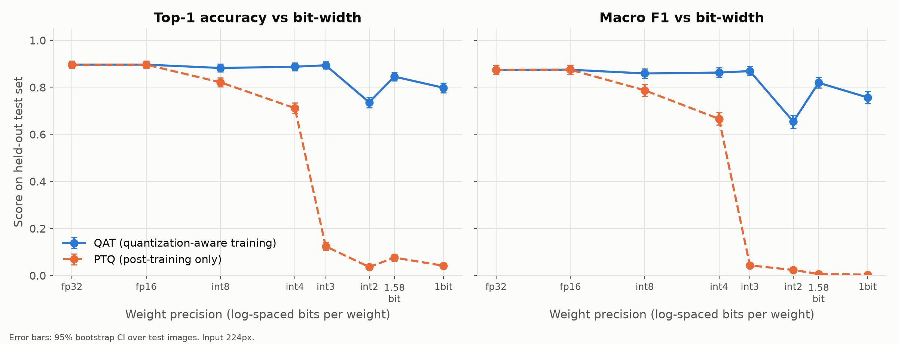

# Quantization in Wildlife Camera Traps

How small can a wildlife species classifier get before it stops being useful?
CSCE 585 (Machine Learning Systems), Fall 2025.

**Report:** [`docs/report/report.pdf`](docs/report/report.pdf) ·
**Slides:** [`docs/presentation/`](docs/presentation/) ·
**Results notebook:** [`notebooks/results_walkthrough.ipynb`](notebooks/results_walkthrough.ipynb) ·
**Video:** `<add YouTube link>`

## Group Info
- Ben Bush (Technical Lead), `<email>@email.sc.edu`
- Victoria Vanlue (Data Lead), `<email>@email.sc.edu`

## Project Summary/Abstract
Camera traps take far more photos than people can label, and the models that label them often have to run
on small, offline computers in the field. We fine-tuned MobileNetV2 on the ENA24 camera-trap dataset
(22 species) and shrank it from 32-bit floats down to 8, 4, 3, 2, 1.58 and 1 bits per weight, either by
rounding after training (PTQ) or by retraining with rounding switched on (QAT). For every version we measured
accuracy, file size, memory, and speed on a cloud CPU and on a simulated 1-core / 1 GB device.

## Problem Description
- **Problem:** find the smallest model that is still accurate enough to label wildlife photos on field hardware.
- **Motivation**
  - Labeling camera-trap photos by hand is slow, costly and needs experts.
  - Field devices are often offline and short on memory and CPU, so a full-size model may not fit or be fast enough.
  - Quantization is the standard way to shrink a model, but its cost on a small, imbalanced wildlife dataset is not well measured.
- **Challenges**
  - Below 8 bits, accuracy collapses unless the model is retrained.
  - PyTorch only has fast 8-bit integer math, so smaller models need a custom storage format and still run at 8-bit speed.
  - Speed and memory measurements are noisy, so every configuration runs in a fresh process and is repeated.

## Contribution
### [`Extension of existing work`]
We build on the integer quantization scheme of Jacob et al. (2018) and the edge camera-trap models of
Hussain et al. (2022), and extend them with:
- a sweep from 32-bit down to 1-bit, comparing PTQ against QAT (progressive, with knowledge distillation);
- a bit-packed model format (`.qpk`) that reloads into the identical model, so file sizes are measured, not estimated;
- a detector → classifier demo app and a 1-CPU / 1 GB "field device" test in Docker.

## Results
MobileNetV2, 224 px, 1,475 test images. Speed and memory are at batch size 1 on the Colab CPU.

| model | accuracy | file size | ms / image | memory |
|---|---|---|---|---|
| 32-bit (fp32) | 89.6% | 9.26 MB | 43.7 | 40 MB |
| 8-bit QAT | 88.2% | 2.37 MB | 19.3 | 10 MB |
| 3-bit QAT | 89.4% | 1.04 MB | 19.4 | 10 MB |
| 1.58-bit QAT | 84.5% | 0.67 MB | 14.4 | 10 MB |
| 1-bit QAT | 79.8% | 0.51 MB | 19.3 | 10 MB |
| 8-bit PTQ | 82.1% | 2.37 MB | 19.2 | 10 MB |
| 3-bit PTQ | 12.4% | 1.04 MB | 19.4 | 10 MB |



- **With retraining (QAT), accuracy holds down to 3 bits** while the file shrinks about 9×. Without retraining (PTQ) it collapses below 4 bits.
- **8-bit is 2.3× faster than 32-bit** (7.6× on the 1-core device) and uses less memory. Going below 8 bits makes the file smaller but not faster.
- **16-bit is 19× slower than 32-bit on CPU**, because CPUs lack fast 16-bit math.

All 14 models and every figure are in [`data/results/`](data/results/) and [`data/figures/mobilenet_v2/`](data/figures/mobilenet_v2/).

## References
BibTeX in [`docs/references.bib`](docs/references.bib). Our proposal is in [`docs/proposal.md`](docs/proposal.md).

---

## Dependencies
- Python 3.10+ (we used 3.12), PyTorch 2.1+. Tested on macOS (Apple Silicon) and on Linux (Google Colab).
- A GPU is only needed for training; everything else runs on CPU.

```bash
uv sync                          # installs from uv.lock (pip users: pip install -r requirements.txt)
uv sync --extra megadetector     # optional: animal detector for the demo app
uv sync --extra notebook         # optional: Jupyter, for the results notebook
```

## Directory Structure
```
run.py                  entry point for every step (python run.py --help)
result.py               makes the figures from data/results/
src/                    the code: data loading, training, quantization, benchmarking, demo app
notebooks/
  colab_run.ipynb       runs the whole experiment on a free Colab GPU (~3 h)
  results_walkthrough.ipynb   explains every result from the CSVs (runs in seconds)
data/
  results/              measurements (CSV) and per-model accuracy (JSON)
  figures/              charts used in the report and slides
  preliminary/          our earlier P1 results, kept for reference
models/                 the trained 32-bit model (quantized models are created here)
examples/               four camera-trap photos for the demo
docs/                   report, slides, proposal, references
scripts/                smoke test and slide builder
Dockerfile.constrained  1-CPU / 1 GB "field device" test
```

## How to Run
**Quick check (5 min, no dataset):**
```bash
python run.py smoke      # runs every step on a tiny fake dataset
python run.py demo       # labels the photos in examples/ with the trained model
```

**Full experiment:** easiest on Colab. Open
[`notebooks/colab_run.ipynb`](https://colab.research.google.com/github/VVanlue/CameraTrapML/blob/colab/notebooks/colab_run.ipynb),
choose a GPU runtime and click *Run all*. It downloads the data, runs every step, and gives you a zip to unzip
into this folder. To run it locally instead, download [ENA24](https://lila.science/datasets/ena24detection)
into `data/raw/` and run:
```bash
python run.py all --images_dir data/raw/images --annotations data/raw/ena24.json --device cuda
python result.py
```
`run.py all` runs `prepare → train → quantize → sweep → plot`; each step can also be run on its own
(`python run.py <step> --help`).

**Small-device test:**
```bash
docker build -f Dockerfile.constrained -t cameratrap-edge .
docker run --rm --cpus=1 --memory=1g -v "$(pwd)/models:/app/models" \
    -v "$(pwd)/data/results:/app/data/results" cameratrap-edge
python result.py
```
The container times the models on `data/results/cache/timing_res224_n96.pt`, which the sweep creates. We only had
the Colab results on the laptop, so we used a random batch of the same shape (speed does not depend on the pixel values):
`python -c "import torch; torch.save(torch.randn(96,3,224,224), 'data/results/cache/timing_res224_n96.pt')"`.

Data splits, training and quantization are seeded, so reruns give the same split and the same training setup.

## Demo
- Video: `<add YouTube link>`
- `python run.py app` opens a local web app. Pick a model (32-bit … 1-bit), drop in a photo from `examples/`,
  and it draws a box around each animal with the species name.
- The box comes from [MegaDetector](https://github.com/microsoft/CameraTraps), an off-the-shelf animal
  detector used only for the demo; none of our measurements depend on it. Our model was trained on cropped
  animals, so without the detector installed the app classifies the whole photo and does much worse.
